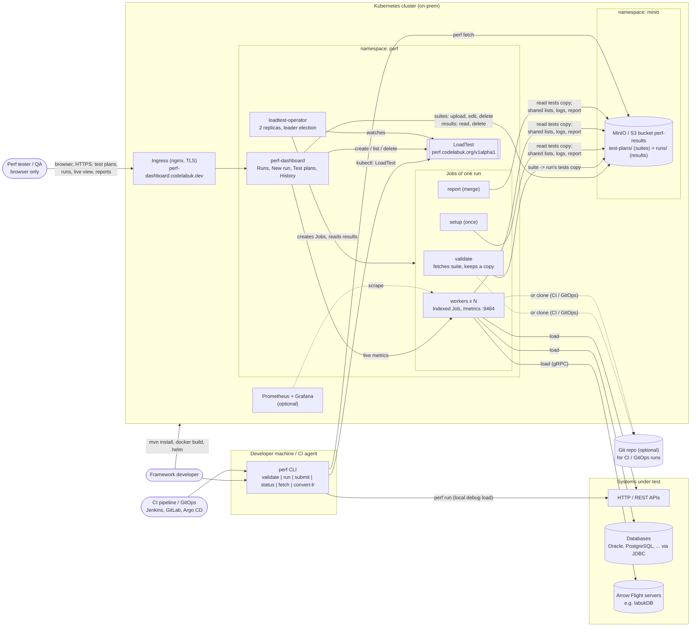
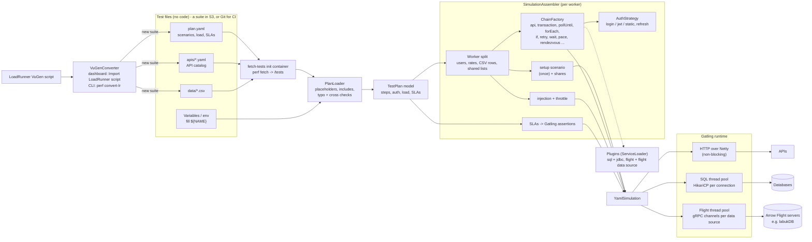
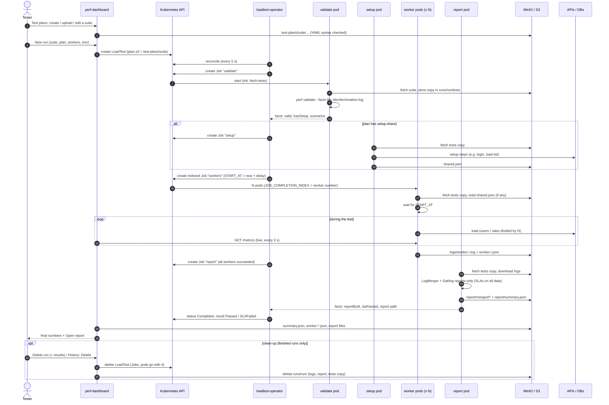
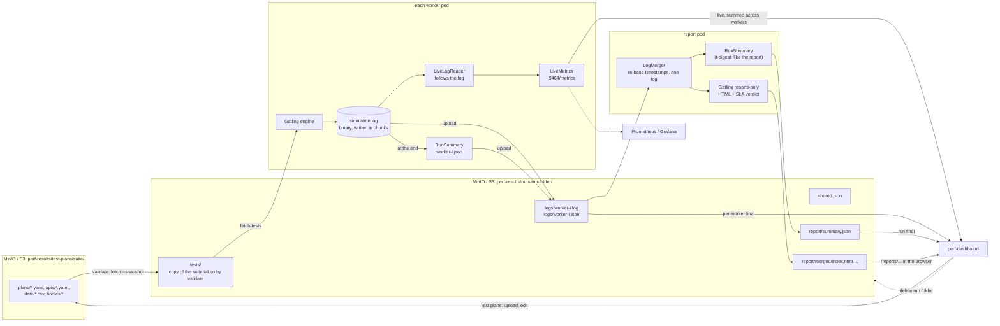
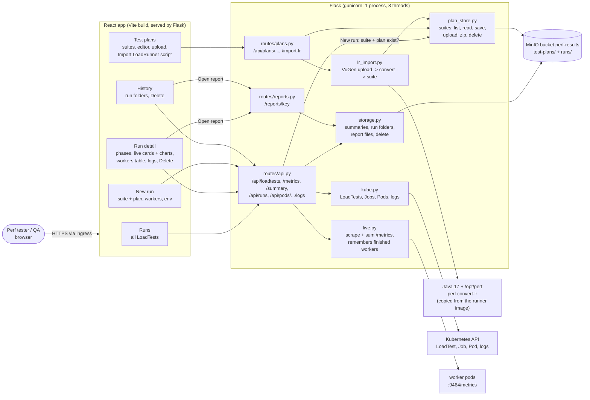
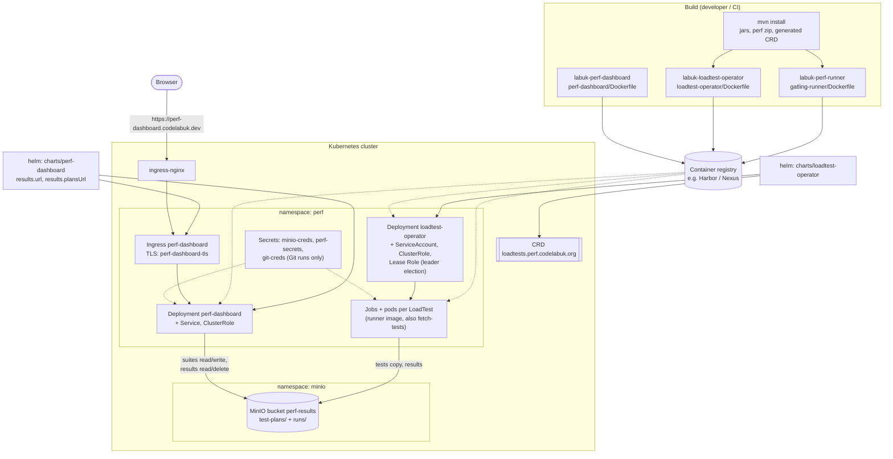

# labuk-gatling — Architecture

A YAML-driven performance testing platform on **open-source Gatling**, built to replace JMeter and
LoadRunner for API and database load tests, and to run them **distributed on an on-prem Kubernetes cluster**
with live tracking and a single, exact result per run.

This document explains how the pieces fit together. For *using* the tools see the [README](../README.md);
for plans and status see the [roadmap](ROADMAP.md); for the dashboard's design see
[perf-dashboard-design.md](perf-dashboard-design.md).

Diagrams are kept as source files in [`docs/architecture/`](architecture/) in two formats:
Mermaid (`.mmd`, rendered by GitHub below) and PlantUML (`.puml`).

---

## Goals and constraints

| Goal | How the architecture answers it |
|---|---|
| **Testers write no code** | Tests are YAML (plan + API catalog + CSV); one generic Gatling simulation runs any plan |
| **Replace JMeter and LoadRunner** | HTTP and SQL/PL-SQL steps, transactions, correlation, think time, pacing, rendezvous, SLAs; a converter for LoadRunner VuGen scripts |
| **No licence cost** | Gatling's open-source edition only (Apache 2.0); everything Gatling Enterprise would add (distribution, merged results, live metrics, a UI) is built here |
| **Distributed on on-prem Kubernetes** | An operator runs each test as Kubernetes Jobs; workers split the load and the data; results are merged into one report |
| **Trustworthy numbers** | One merged log per run, SLAs judged on all data, dashboard percentiles computed exactly like Gatling's report |
| **Runs anywhere** | The same `perf` command on a laptop, a VM, in CI and inside pods |

Fixed technology choices: Java 17, Scala 2.13.15, **Gatling 3.13.1** (pinned - newer 3.13.x moved to Scala
2.13.16), Java Operator SDK 5.1.1 on fabric8 7.3.1, Flask + React for the dashboard.

---

## Components at a glance

| Component | Technology | Responsibility | Location |
|---|---|---|---|
| **gatling-api-core** | Scala | YAML loading and validation, the engine (steps, auth, data, load, SLAs), worker split, log merging, live metrics, run summaries | `gatling-api-core/` |
| **gatling-sql** | Scala, HikariCP | `sql` steps (query, update, call, batch) and `jdbc` data sources, as plugins | `gatling-sql/` |
| **gatling-flight** | Scala, Arrow Flight 16.1 (gRPC) | `flight` steps (GetFlightInfo + DoGet, DoPut) and `flight` data sources, as plugins | `gatling-flight/` |
| **gatling-runner** | Scala | The `perf` command: validate, run, setup, worker, report, fetch (with `--snapshot`), submit, status, convert-lr; S3 client; distribution zip and image | `gatling-runner/` |
| **loadtest-operator** | Java, JOSDK | Watches `LoadTest` resources and runs each as validate → setup → workers → report Jobs; gets the tests into every pod (S3 suite, Git, ConfigMap or image) | `loadtest-operator/` |
| **perf-dashboard** | Python Flask, React | Test plans (suites in S3: upload, edit), new runs, live metrics per worker, final numbers, logs, reports from S3, deleting runs and their results | `perf-dashboard/` |
| **Helm charts** | Helm 3 | Install the operator (+ CRD) and the dashboard | `charts/` |
| **MinIO / S3** | (existing) | One bucket, two areas: `test-plans/` (suites of test files) and `runs/` (per run: test copy, shared lists, worker logs and summaries, merged report) | cluster service |

---

## 1. System context



<sub>Source: [`architecture/01-system-context.mmd`](architecture/01-system-context.mmd) · PlantUML: [`architecture/01-system-context.puml`](architecture/01-system-context.puml)</sub>

**Testers use only the dashboard** (a browser): they keep their test files as **suites in MinIO**
(`test-plans/<suite>/`) on the *Test plans* page, start runs, watch them live and open the reports. The **`perf`
CLI** is for framework developers (local debug runs, `perf convert-lr` for LoadRunner scripts) and for CI
pipelines; GitOps can apply a `LoadTest` from Git. CLI and GitOps runs may take the tests from a Git repository
instead. Either way a `LoadTest` resource is
created in Kubernetes. The **operator** turns it into Jobs whose pods run the **perf runner image**: the validate
pod fetches the suite and stores a **copy in the run folder**, every later pod reads that copy, the workers load
the **systems under test**, and everything is written to **MinIO**. The dashboard reads the cluster (status,
pods, logs), the workers (live metrics) and MinIO (final numbers, reports), and can delete finished runs and
their results. Prometheus/Grafana can scrape the same worker metrics.

---

## 2. Modules

```mermaid
%% 2. Modules and their dependencies
flowchart TB
    subgraph repo["labuk-gatling repository"]
        direction TB
        subgraph core["gatling-api-core (Scala)"]
            core_load["load<br/>PlanLoader, Node, RunOptions, LoadMath"]
            core_model["model<br/>TestPlan, Step, ApiDef, LoadDef, SlaDef"]
            core_build["build<br/>SimulationAssembler, ChainFactory,<br/>AuthStrategy, RecordResult"]
            core_sim["sim<br/>YamlSimulation"]
            core_data["data<br/>CSV, RecordSource, Worker split, SharedFile"]
            core_expr["expr<br/>Condition, Durations"]
            core_results["results<br/>LogMerger"]
            core_metrics["metrics<br/>LiveLogReader, LiveMetrics, RunSummary"]
            core_cli["cli<br/>Validate, Merge"]
            core_plugin["plugin SPI<br/>StepPlugin, DataSourcePlugin"]
        end
        subgraph sql["gatling-sql (Scala)"]
            sql_plugins["SqlStepPlugin, JdbcDataSourcePlugin"]
            sql_exec["SqlAction, SqlExecutor, Pools (HikariCP)"]
        end
        subgraph flight["gatling-flight (Scala)"]
            fl_plugins["FlightStepPlugin, FlightDataSourcePlugin"]
            fl_exec["FlightAction, FlightExecutor, FlightPools<br/>(Arrow Flight 16.1, gRPC 1.76)"]
        end
        subgraph runner["gatling-runner (Scala)"]
            perf["Perf CLI<br/>incl. fetch --snapshot"]
            kube["Kube: submit / status"]
            s3["S3 client (SigV4)"]
            lr["lr.VuGenConverter"]
            dist["perf-x.zip + Dockerfile"]
        end
        subgraph operator["loadtest-operator (Java)"]
            op_crd["LoadTest CRD (generated)<br/>plan: s3 | git | configMap | inImage"]
            op_flow["LoadTestReconciler, LoadTestFlow"]
            op_jobs["JobFactory<br/>fetch-tests / clone-tests init containers"]
        end
        subgraph dashboard["perf-dashboard (Python + TypeScript)"]
            dash_api["Flask routes<br/>api (runs, delete), plans, reports"]
            dash_store["kube, live, storage,<br/>plan_store (suites in S3), lr_import"]
            dash_ui["React<br/>Runs, Run detail, New run,<br/>Test plans, History"]
        end
        subgraph charts["Helm charts"]
            chart_op["charts/loadtest-operator"]
            chart_dash["charts/perf-dashboard"]
        end
    end

    gatling["Gatling 3.13.1 (open source)<br/>Scala 2.13.15"]
    josdk["Java Operator SDK 5.1.1<br/>fabric8 7.3.1"]

    core_load --> core_model
    core_build --> core_model & core_expr & core_data & core_plugin & core_metrics
    core_sim --> core_load & core_build & core_metrics
    core_cli --> core_load & core_results
    core --> gatling
    sql_plugins -.->|"implements"| core_plugin
    sql --> core
    fl_plugins -.->|"implements"| core_plugin
    flight --> core
    runner --> sql & flight
    perf --> core_cli & core_sim & core_metrics & s3 & kube & lr
    operator --> josdk
    op_flow --> op_jobs
    op_jobs -.->|"pods run the runner image"| dist
    op_crd -.->|"copied into"| chart_op
    dash_ui --> dash_api --> dash_store
    dash_store -.->|"reads / creates LoadTests"| op_crd
    dash_store -.->|"runs convert-lr (Java + perf from the runner image)"| lr
    chart_dash -.-> dashboard
```



<sub>Source: [`architecture/02-modules.mmd`](architecture/02-modules.mmd) · PlantUML: [`architecture/02-modules.puml`](architecture/02-modules.puml)</sub>

| Module / package | Contents |
|---|---|
| `core/load` | `PlanLoader` (YAML → model, `${NAME}` placeholders, includes, typo and cross-reference checks), `RunOptions`, `LoadMath` |
| `core/model` | The plan model: `TestPlan`, `ApiDef`, `Step` (all step types), `LoadDef`, `SlaDef`, `AuthDef` — no Gatling types |
| `core/build` | `SimulationAssembler` (per-worker populations, setup and shares, injection, throttle, SLAs), `ChainFactory` (steps → Gatling chains), `AuthStrategy`, `RecordResult` |
| `core/sim` | `YamlSimulation` — the one generic Gatling simulation |
| `core/data`, `core/expr` | CSV, record strategies, worker slicing, shared lists; conditions and durations |
| `core/results` | `LogMerger` — combines workers' binary logs |
| `core/metrics` | `LiveLogReader` (follows a growing log), `LiveMetrics` (Prometheus endpoint), `RunSummary` (exact JSON summaries) |
| `core/cli` | `Validate`, `Merge` |
| `core/plugin` | Extension points `StepPlugin`, `DataSourcePlugin` (Java `ServiceLoader`) |
| `gatling-sql` | `SqlStepPlugin`, `JdbcDataSourcePlugin`, `SqlAction` (own thread pool), `SqlExecutor`, `Pools` |
| `gatling-flight` | `FlightStepPlugin`, `FlightDataSourcePlugin`, `FlightAction` (own thread pool), `FlightExecutor` (plan, parallel DoGet, DoPut, Arrow value conversion), `FlightPools` |
| `gatling-runner` | `Perf` (CLI; `fetch --snapshot` copies a test folder into the run folder), `Kube` (submit/status via kubectl), `S3` (SigV4 client), `lr.VuGenConverter`, `Facts` |
| `loadtest-operator` | `LoadTest` CRD classes (plan sources `s3`, `git`, `configMap`, `inImage`), `LoadTestReconciler`, `LoadTestFlow` (state machine), `JobFactory` (Jobs, `fetch-tests` / `clone-tests` init containers) |
| `perf-dashboard` | `routes/api.py` (runs, delete), `routes/plans.py` (suites), `routes/reports.py`; `kube.py`, `live.py`, `storage.py`, `plan_store.py`; React pages Runs, Run detail, New run, Test plans, History |

Dependencies point one way: `gatling-runner → gatling-sql / gatling-flight → gatling-api-core → Gatling`. The operator does not
link the engine — it starts pods from the runner image. The dashboard talks to the Kubernetes API, the worker
pods and S3, never to the engine directly.

---

## 3. How a test is defined

A test is data, not code:

```
s3://perf-results/test-plans/orders-api/     a suite (Test plans page) - or a Git repository for CI / GitOps
├── apis/orders.yaml             API catalog: each request defined once (method, path, headers, body, checks, extract)
├── data/users.csv               test data, one row per virtual user (queue / circular / random / shuffle)
├── bodies/create-order.json     request bodies with #{variables}
└── plans/orders-peak.yaml       scenarios (steps), load profile, auth, setup, SLAs
```

- **Suites**: a suite is a folder of test files laid out like a test repository, so `include:` and data paths
  (relative to the file they are written in) work the same everywhere. The *Test plans* page creates suites (with
  a starter plan), uploads files, a folder or a zip (folders kept), edits YAML/CSV in the browser (YAML syntax is
  checked on save), downloads a suite as zip and deletes files or suites. A YAML file with `scenarios:` is offered
  as a plan on *New run*.

- **Steps**: `api`, `sql`, `transaction`, `pollUntil`, `forEach`, `repeat`, `loop`, `if`, `randomSwitch`,
  `retry`, `wait`, `pace`, `rendezvous`, `set`, `feed`, `log`, `stopUserIfFailed`.
- **Variables**: `#{name}` at run time (CSV columns, extracted values); `${NAME}` at load time (environment —
  e.g. `BASE_URL` per environment, secrets from Kubernetes Secrets).
- **Load**: open (arrival rate), closed (concurrency) and stepped models; rates in `/s`, `/min`, `/h`; throttle.
- **SLAs**: `global.*`, `api.<name>.*`, `transaction.<name>.*` response-time percentiles, error %, throughput.
- **LoadRunner**: a VuGen web script (`vuser_init.c`, `Action*.c`, `vuser_end.c`, `.prm`/`.dat`) is converted
  into the same files, with a report of anything not converted — by testers with **Import LoadRunner script** on
  the *Test plans* page (the result becomes a new suite), by developers and CI with `perf convert-lr`. Both run
  the same converter: the dashboard image carries Java and the perf distribution from the runner image.

---

## 4. Engine



<sub>Source: [`architecture/05-engine.mmd`](architecture/05-engine.mmd) · PlantUML: [`architecture/05-engine.puml`](architecture/05-engine.puml)</sub>

1. **Load and validate** — `PlanLoader` resolves `${NAME}`, follows `include`s (paths are relative to the file
   they are written in), and rejects mistakes with the exact file and YAML path: unknown keys, undefined APIs or
   feeders, invalid conditions or durations, SLA targets that do not exist, a `pollUntil` that could never end.
2. **Assemble for this worker** — `SimulationAssembler` divides users, rates and throttle targets by the worker
   count, slices CSV rows and shared lists so no two workers use the same item, builds the optional **setup**
   scenario (runs once, then hands lists to the users), the scenario chains, injection profiles and SLA
   assertions.
3. **Run** — `YamlSimulation` hands everything to Gatling. HTTP runs on Gatling's non-blocking Netty event
   loops; **SQL runs on its own thread pool** (one per connection pool) so blocking JDBC calls never distort
   HTTP timings.

**Extension points**: a new step type or data source is a class implementing `StepPlugin` /
`DataSourcePlugin`, registered under `META-INF/services` and placed on the classpath — `gatling-sql` is built
exactly this way. Plugins can declare report names so SLAs can target their steps.

**Runtime safeguards** built into the engine and launcher:
- Gatling 3.13 deadlocks at start-up when the JVM sees **one CPU**; `perf` restarts itself with
  `-XX:ActiveProcessorCount=2` (thread counts only — the CPU limit still applies).
- A throttle shorter than the load silently ends the scenario in Gatling; validate and run warn about it.
- Gatling's anonymous usage analytics are switched off.

---

## 5. Distributed runs



<sub>Source: [`architecture/03-run-lifecycle.mmd`](architecture/03-run-lifecycle.mmd) · PlantUML: [`architecture/03-run-lifecycle.puml`](architecture/03-run-lifecycle.puml)</sub>

A run is one `LoadTest` resource (`perf.codelabuk.org/v1alpha1`). `LoadTestFlow` is an idempotent state
machine — every reconcile looks at what exists and moves one step, so an operator restart simply continues.

| Phase | Job | What happens | Result passed back |
|---|---|---|---|
| Validating | `<run>-validate` | `perf validate --workers N`; a bad plan stops here | facts JSON via `/dev/termination-log`: valid, hasSetup, scenarios, error message |
| Setup | `<run>-setup` | `perf setup` — only if the plan has `setup.share`; runs **once** for the whole test | `shared.json` in the run folder |
| Starting → Running | `<run>-workers` | **Indexed Job** with N pods; `JOB_COMPLETION_INDEX` = worker number; all wait for `START_AT` (creation + `startDelaySeconds`) | `worker-<i>.log` + `worker-<i>.json` |
| Aggregating | `<run>-report` | `perf report`: merge logs, build the HTML report, judge SLAs | facts JSON: reportBuilt, slaPassed, report path |
| Completed / Failed | — | `status.result` = `Passed` / `SLAFailed`, or the reason for failure | |

Design points:
- **Facts through termination messages** — validate and report containers write a small JSON to
  `/dev/termination-log`; the operator reads it from the pod status. No extra API, no shared volume needed.
- **No retries for workers** (`backoffLimit: 0`) — a retried worker would start late and skew the test; a crash
  fails the run with the reason.
- **Leader election** (a Lease in the operator's namespace) — two operator replicas are safe; one works.
- **Ownership** — every Job is owned by its LoadTest: deleting the LoadTest stops and removes the run.
- **Tests in every pod** — `plan.s3` (a suite in S3; the dashboard's only source): the validate pod's
  `fetch-tests` init container runs `perf fetch <suite> /tests --snapshot <run folder>/tests`; setup, workers and
  report fetch that copy. Editing a suite therefore never changes a running test, and the run folder shows exactly
  what ran. It uses the endpoint and credentials of `results.s3`. For CI and GitOps the operator also takes
  **Git** (init container fetches a branch, tag or commit), a **ConfigMap** (small, flat, 1 MB; what
  `perf submit --from-dir` creates) or tests **baked into the image**.
- **Secrets** reach pods only as environment variables from Kubernetes Secrets.

The same sequence works without Kubernetes: `perf setup`, N × `perf worker` with `WORKER_INDEX` /
`WORKER_COUNT` / `START_AT`, then `perf report`.

---

## 6. Results and metrics



<sub>Source: [`architecture/04-results-flow.mmd`](architecture/04-results-flow.mmd) · PlantUML: [`architecture/04-results-flow.puml`](architecture/04-results-flow.puml)</sub>

**Run folder** (S3 / MinIO, or a shared volume):

```
perf-results/runs/<run>-<uid8>/
├── tests/                          copy of the suite taken by the validate pod (runs from S3 plans)
├── shared.json                     setup's lists (when the plan has setup)
├── logs/worker-<i>.log             each worker's Gatling log (binary)
├── logs/worker-<i>.json            each worker's final numbers
└── report/
    ├── summary.json                the run's final numbers + SLA verdict
    └── merged/index.html …         the merged Gatling HTML report
```

- **One result per run.** Gatling 3.13 writes a binary `simulation.log` and its reports-only mode reads exactly
  one file, so `LogMerger` rewrites all workers' records into one log (timestamps re-based to the earliest start,
  string cache rebuilt, SLAs kept from the header). Gatling then builds the report and judges the SLAs **on all
  the data** — a single worker's SLA printout is informational only.
- **Live metrics without Gatling Enterprise.** Each worker follows its own log while Gatling writes it
  (`LiveLogReader` handles records cut off mid-write) and serves Prometheus metrics on `:9464/metrics`. The
  numbers come from the same records as the report. Gatling writes the log in chunks, so live numbers trail by
  ~1 s at high load and up to ~20 s at a trickle (`perf` halves the chunk size when metrics are on).
- **Exact final numbers.** `RunSummary` computes counts and percentiles from the log with the same t-digest
  (compression 100, values in log order) as Gatling's report, so the dashboard and the HTML report agree.

---

## 7. perf-dashboard



<sub>Source: [`architecture/07-dashboard-components.mmd`](architecture/07-dashboard-components.mmd) · PlantUML: [`architecture/07-dashboard-components.puml`](architecture/07-dashboard-components.puml)</sub>

The main flows (test plans, LoadRunner import, start a run, live view, report, delete) are in
[`08-dashboard-flows`](architecture/08-dashboard-flows.mmd); the full design is in
[perf-dashboard-design.md](perf-dashboard-design.md).

| Concern | Design |
|---|---|
| Live view | Backend scrapes every running worker's `/metrics` in parallel and sums them; the browser turns successive samples into rates. The last numbers of finished workers are remembered so totals never decrease (one gunicorn process, threads for concurrency) |
| Final view | `summary.json` + `worker-*.json` from S3 — available after the pods are gone |
| Reports | `/reports/<key>` streams the report files from S3; only keys under the results prefix, `..` rejected |
| Test plans | `/api/plans/...`: list / create / delete suites, list / read / save / delete files, upload (multipart; zips unpacked, a single top folder removed, hidden files skipped), download as zip. Paths are checked so nothing can leave its suite (`..`, absolute paths, hostile zip entries); an upload is checked completely before anything is written |
| Starting runs | `POST /api/loadtests` builds and validates a LoadTest from a **saved suite** (the plan file must exist in it), workers, resources, env, secrets. Git / ConfigMap sources are not offered here |
| Deleting | `DELETE /api/loadtests/<ns>/<name>` removes the LoadTest (Jobs, pods); `?results=true` also removes its run folder. `DELETE /api/runs/<folder>` (History) removes a run folder. Both are refused (409) while the run is active |
| Access to the cluster | A ClusterRole: LoadTests get/list/watch/create/delete, Jobs get/list, Pods and logs get/list |
| Access to S3 | One credentials Secret: read/write/delete on `test-plans/`, read/delete on `runs/` |
| Local mode | Without Kubernetes or Docker: runs become local `perf` processes (`local_runs.py`) and storage a folder (`folder_store.py`), behind the same API and UI; packaged as `perf-dashboard-local.zip` (Java + Python only) |

---

## 8. Deployment



<sub>Source: [`architecture/06-deployment.mmd`](architecture/06-deployment.mmd) · PlantUML: [`architecture/06-deployment.puml`](architecture/06-deployment.puml)</sub>

| Artifact | Built by | Notes |
|---|---|---|
| `labuk-perf-runner` | `gatling-runner/Dockerfile` (or Jib) | Non-root; heap = 75 % of the container memory limit; extra JDBC drivers in `/opt/perf/drivers` |
| `labuk-loadtest-operator` | `loadtest-operator/Dockerfile` (or Jib) | One or two replicas |
| `labuk-perf-dashboard` | `perf-dashboard/Dockerfile` | Node build stage, Python runtime, plus Java and `/opt/perf` from the runner image (LoadRunner import) — build the runner image first |
| `charts/loadtest-operator` | Helm | CRD in `crds/` (kept identical to the generated one by the build), RBAC, Lease role, Deployment |
| `charts/perf-dashboard` | Helm | RBAC, Deployment, Service, optional Ingress with TLS |

**Configuration** is environment-based throughout: the runner reads `PLAN`, `WORKER_INDEX` /
`JOB_COMPLETION_INDEX`, `WORKER_COUNT`, `START_AT`, `SHARED_IN`, `RESULTS_DIR`, `METRICS_PORT`, S3 variables
(`AWS_ACCESS_KEY_ID`, `AWS_SECRET_ACCESS_KEY`, `AWS_REGION`, `S3_ENDPOINT`) and any `${NAME}` the plan uses.
The dashboard reads `WATCH_NAMESPACES`, `RESULTS_URL`, `PLANS_URL` (chart: `results.url`, `results.plansUrl`),
`S3_ENDPOINT`, the S3 credentials and the defaults for new runs (`DEFAULT_IMAGE`, `DEFAULT_S3_SECRET`).

**Storage choice on-prem**: MinIO/S3 (`results.s3`, no shared volume needed — recommended, and required for
saved test plans and the dashboard's numbers) or a ReadWriteMany volume such as NFS (`results.pvc`).

```
s3://perf-results/
├── test-plans/<suite>/...         suites (Test plans page)
└── runs/<run>-<uid8>/...          one folder per run (see Results and metrics)
```

For routine clean-up prefer a bucket lifecycle rule (e.g. expire `runs/` after 90 days) over deleting by hand.

---

## 9. Security

| Area | Measure |
|---|---|
| Pods | Run as non-root (uid 1000); dashboard and operator containers drop all capabilities |
| Secrets | Passwords and tokens only through Kubernetes Secrets (`secretRefs`, Git token secret, S3 credentials secret); never in YAML or the LoadTest spec |
| RBAC | Operator: LoadTests, Jobs, Pods (read), Leases in its namespace. Dashboard: LoadTests incl. create/delete, Jobs and Pods read |
| Writes to databases | `sql` update/call/batch steps are refused unless the connection has `allowWrites: true`; `rollback: true` measures writes without keeping them |
| Report serving | Only objects under the results prefix; path traversal rejected |
| Test plans | Suite and file names checked (no `..`, absolute or hidden paths, hostile zip entries); file size limit (20 MB, configurable); uploads checked completely before anything is written |
| Deleting results | Only folders under the results prefix; refused while the run is active; cannot be undone |
| Outbound data | Gatling usage analytics disabled |
| **Gap** | The dashboard has **no login** (v1): anyone who can open it can edit test plans and delete results — keep it behind the ingress / network rules (or SSO in front of it); SSO is on the roadmap |

---

## 10. Key design decisions

| Decision | Why | Consequence |
|---|---|---|
| Open-source Gatling 3.13.1, pinned | No licence cost; required Scala 2.13.15 | Log merger and live reader depend on 3.13.1's log format — re-check on upgrades |
| One generic simulation + YAML | Testers write no code; one engine to maintain | New behaviour = new step type (plugin), not new scripts |
| Own log merger | Gatling 3.13's reports-only mode reads one log | One report and one SLA verdict per distributed run |
| Live metrics by following the log | Gatling OSS has no Graphite/streaming output | Live = report numbers; latency depends on log chunks |
| t-digest summaries | Dashboard must match the HTML report | Same percentiles everywhere |
| Kubernetes Jobs per phase, Indexed workers | Standard objects, worker number for free, clean ownership | Start time fixed at creation (`startDelaySeconds` must cover image pulls) |
| Facts via termination messages | No extra endpoint or shared storage between pods and operator | Facts limited to ~4 KB |
| Polling reconcile (5 s) | Simple, restart-safe; tests run for minutes | Up to 5 s latency between phases |
| Own S3 client (SigV4) | Avoids the large AWS SDK; MinIO-friendly | Access keys only (no IRSA / web identity) |
| SQL on its own thread pool | JDBC blocks | Accurate HTTP timings next to SQL load |
| Flight on its own thread pool, plugin like SQL | Flight's Java client blocks; Flight is a protocol, not core | Accurate timings next to HTTP; nothing in the core knows about Arrow |
| One Netty (4.1.115) and gRPC 1.76 for every module | Arrow Flight 16.1 brings gRPC 1.63 (built for Netty 4.1.100) and Netty 4.1.100/108; with Gatling's 4.1.115 its HTTP/2 streams broke. Arrow's Netty buffer patch is excluded (`arrow-memory-unsafe` instead) | Gatling keeps its own Netty; re-check the alignment when upgrading Gatling or Arrow |
| Dockerfiles alongside Jib | Jib's hand-off to Docker Desktop stalled on the dev laptop | Both paths documented; Dockerfiles verified |
| Test plans in S3, managed by the dashboard | Testers should not need Git or a push for every change; the bucket is already there | Git stays available to CI / GitOps through the operator |
| Per-run copy of the tests, taken by the validate pod | A run must not change if a plan is edited while it runs; the run folder name (`<name>-<uid>`) only exists once the LoadTest is created, so the dashboard cannot copy reliably before the pods start | Every run folder shows exactly what ran; works for `perf submit` / kubectl runs too |
| Results kept when a run is deleted (unless asked) | Results are the record; the LoadTest is only cluster state | Explicit "also delete results" / History delete; lifecycle rules for routine clean-up |

---

## 11. Known limits

- Workers are not yet spread one per node (no anti-affinity / topology spread) — on multi-node clusters
  several workers may share a node.
- `rendezvous` waits per worker; small `throttle` targets are rounded per worker (minimum 1 rps each).
- ConfigMap test sets (`perf submit --from-dir`) are flat (no sub-folders) and limited to 1 MB.
- Saving a test file checks YAML syntax only; the full plan check (APIs, data files, SLA targets) runs in the run's
  validate step. There is no edit history apart from the per-run copies — enable MinIO bucket versioning for that.
- The Git source's clone init container fails on clusters where the tests volume is owned by root while git runs
  as uid 1000 (`detected dubious ownership`, seen on Docker Desktop) — a one-line `safe.directory` fix is pending;
  it does not affect S3 test plans.
- The dashboard reads results from S3 only; runs with `results.pvc` show status and pods but no numbers.
- Oracle-specific behaviour (REF CURSOR, PL/SQL OUT parameters) is implemented but not yet verified on a real
  Oracle database.
- Flight: no `DoAction` / `DoExchange` and no Flight SQL commands yet; writes support the listed scalar types
  (no nested lists / structs / decimals from YAML text other than plain numbers).

---

## Diagram sources

| View | Mermaid | PlantUML |
|---|---|---|
| System context | [01-system-context.mmd](architecture/01-system-context.mmd) | [01-system-context.puml](architecture/01-system-context.puml) |
| Modules | [02-modules.mmd](architecture/02-modules.mmd) | [02-modules.puml](architecture/02-modules.puml) |
| Run lifecycle | [03-run-lifecycle.mmd](architecture/03-run-lifecycle.mmd) | [03-run-lifecycle.puml](architecture/03-run-lifecycle.puml) |
| Results and metrics | [04-results-flow.mmd](architecture/04-results-flow.mmd) | [04-results-flow.puml](architecture/04-results-flow.puml) |
| Engine | [05-engine.mmd](architecture/05-engine.mmd) | [05-engine.puml](architecture/05-engine.puml) |
| Deployment | [06-deployment.mmd](architecture/06-deployment.mmd) | [06-deployment.puml](architecture/06-deployment.puml) |
| perf-dashboard components | [07-dashboard-components.mmd](architecture/07-dashboard-components.mmd) | [07-dashboard-components.puml](architecture/07-dashboard-components.puml) |
| perf-dashboard flows | [08-dashboard-flows.mmd](architecture/08-dashboard-flows.mmd) | [08-dashboard-flows.puml](architecture/08-dashboard-flows.puml) |

Render them with GitHub (Mermaid, automatic), [mermaid.live](https://mermaid.live), the IntelliJ / VS Code
Mermaid and PlantUML plugins, or `java -jar plantuml.jar -tsvg docs/architecture/*.puml`.

The PlantUML files share one look from [`_theme.iuml`](architecture/_theme.iuml) (keep it next to them):
blue = control plane, green = run pods, amber = results/storage, red = systems under test,
purple = engine code, sand = test files, grey = build, teal = live metrics. Arrows use the same colours
(control, **load**, results data, dashed live metrics); every diagram has a legend.
