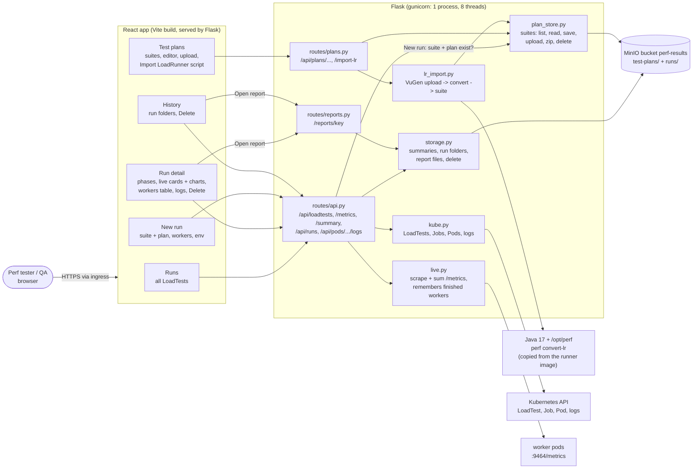
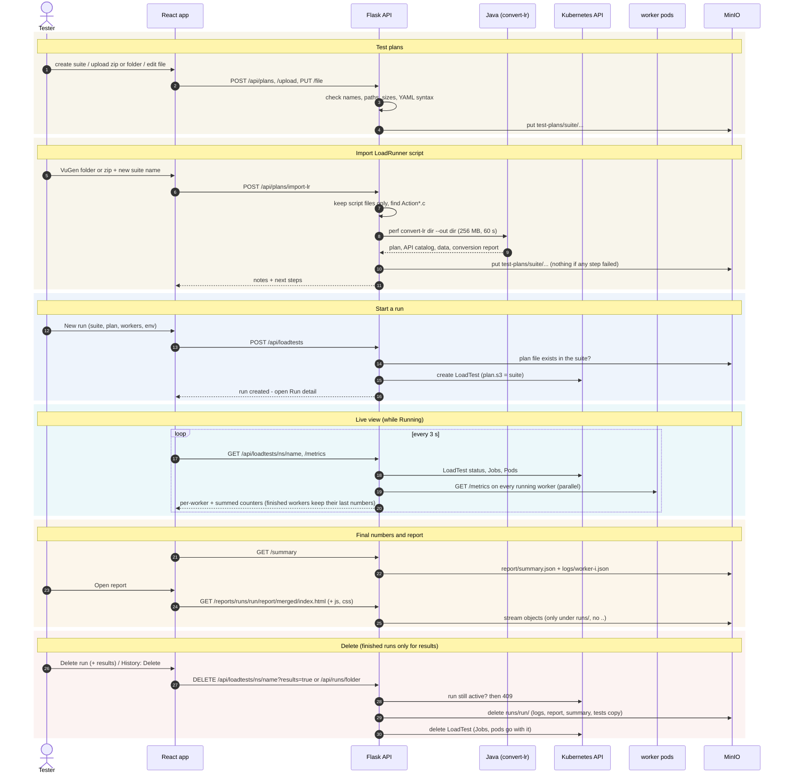

# perf-dashboard — design

A web UI for distributed load tests on Kubernetes: what Spark's driver UI + history server are for Spark jobs,
plus a place to keep the tests themselves. It lives in this repo (`perf-dashboard/`), is deployed with its own
Helm chart, and uses the same stack as the team's spark-dashboard (Flask + Kubernetes/MinIO clients, React +
react-query + Vite) so one team can run both.

Testers never need Git, kubectl or a push: they keep their test files as **suites** in MinIO, start runs from a
suite, watch them live, open the merged report and clean up — all in the browser. CI pipelines and GitOps keep
using the `perf` CLI / LoadTest resources, which also accept Git or a ConfigMap as the test source.

## What it shows

| Page | Content | Data source |
|---|---|---|
| **Runs** (home) | Every LoadTest: name, plan, phase, result, workers done/total, start, duration; auto-refresh | Kubernetes API (`LoadTest` resources) |
| **Run detail** | Phase timeline; summary cards (requests, errors %, req/s, p95); live chart while running; per-request table; **workers table** (pod, node, state, restarts, live req/s and users per worker, log viewer); **Report** button; the LoadTest spec; **Delete** (optionally *also delete results in S3*) | Kubernetes API, worker `/metrics`, MinIO |
| **Report** | The merged Gatling HTML report, served straight from MinIO in the browser | MinIO (`perf-results/runs/<run>/report/merged/…`) |
| **New run** | Form: **suite + plan** (dropdowns of saved test plans), workers, image, env, secrets, CPU/memory, start delay → creates a LoadTest | MinIO (suites), Kubernetes API |
| **Test plans** | Suites of test files: create (with a starter plan), upload files / a folder / a zip, **import a LoadRunner VuGen script**, edit YAML and CSV in the browser, download as zip, delete files or suites, **Run** a plan | MinIO (`perf-results/test-plans/<suite>/…`) |
| **History** | All run folders in MinIO, including runs whose LoadTest was deleted, with their final numbers; **Delete** a run's results | MinIO (`summary.json`) |

## Architecture

```
Browser ──► perf-dashboard pod (gunicorn + Flask, serves the built React app)
              ├─ Kubernetes API : LoadTests (list/get/create/delete), their Jobs and pods, pod logs
              ├─ worker pods    : GET http://<pod-ip>:<metrics port>/metrics  (only while the run is Running)
              └─ MinIO / S3     : test-plans/<suite>/…  (read / write / delete)
                                  runs/<run>/…          (summaries, report files; delete)
```

### Components



<sub>Source: [`architecture/07-dashboard-components.mmd`](architecture/07-dashboard-components.mmd) · PlantUML: [`architecture/07-dashboard-components.puml`](architecture/07-dashboard-components.puml)</sub>

Each page talks only to the Flask API; the API is the only part that reaches Kubernetes, the worker pods, MinIO
and the converter. `routes/*` validate input and map errors to readable messages; `kube.py`, `live.py`,
`storage.py`, `plan_store.py` and `lr_import.py` each own one outside system.

### Main flows



<sub>Source: [`architecture/08-dashboard-flows.mmd`](architecture/08-dashboard-flows.mmd) · PlantUML: [`architecture/08-dashboard-flows.puml`](architecture/08-dashboard-flows.puml)</sub>

### Test plans and the per-run copy

```
s3://perf-results/
├── test-plans/<suite>/                 edited on the Test plans page
│   ├── plans/*.yaml   apis/*.yaml   data/*.csv   bodies/*
└── runs/<run>-<uid8>/
    ├── tests/                          copy of the suite, taken when the run starts
    ├── shared.json   logs/…   report/…
```

1. A run created from the dashboard is a LoadTest with `spec.plan.s3 = s3://perf-results/test-plans/<suite>` and
   `spec.plan.file = <plan path in the suite>` (the backend checks the file exists).
2. The operator gives every pod of the run a `fetch-tests` init container (the runner image itself). In the
   **validate** pod it runs `perf fetch <suite> /tests --snapshot <run folder>/tests`; setup, workers and report
   run `perf fetch <run folder>/tests /tests`.
3. So editing or deleting a suite never changes a test that is already running, and every run folder shows
   exactly which files ran. The copy is taken by the validate pod rather than by the dashboard because the run
   folder name (`<name>-<uid>`) only exists once Kubernetes has created the LoadTest — copying from the dashboard
   would race the pods; it also makes `perf submit` / kubectl runs with `plan.s3` behave the same.

A suite is laid out like a test repository, so `include:` and data paths (relative to the file they are written
in) work unchanged. A YAML file with a top-level `scenarios:` is listed as a plan.

**Uploads**: multipart; each file is sent under its path in the suite. A zip is unpacked keeping its folders; a
zip of one folder loses that folder's name (so zipping `sr-flow/` gives `plans/…`, not `sr-flow/plans/…`);
macOS metadata and hidden files (`.git`, `.DS_Store`) are skipped. The whole upload is checked first — names,
sizes, YAML syntax — and nothing is written if any file fails.

**Saving** checks YAML syntax only. The full plan check (unknown keys, APIs, data files, SLA targets) runs in the
run's validate step and shows up as the run's error message.

### Import LoadRunner script

Testers convert VuGen **web (HTTP/HTML)** scripts without the CLI. The tester picks the script folder or a zip,
a new suite name and the Action iterations. The backend (`lr_import.py`):
1. keeps only script files (`.c`, `.h`, `.prm`, `.dat`, `.usr`, `.cfg`, `.csv`, `.txt`) — recording snapshots,
   logs and result folders are skipped; paths that leave the folder reject the upload;
2. finds the script folder (where `Action*.c` / `vuser_init.c` are; more than one script is refused);
3. runs the real converter: `java … org.codelabuk.perf.runner.Perf convert-lr <dir> --out <dir> --iterations N`
   (heap 256 MB, 60 s timeout). Java and the perf distribution are copied **from the runner image** into the
   dashboard image, so the dashboard and the CLI always convert the same way;
4. stores the output (plan named after the script's `.usr` / `.prm`, API catalog, data, `<name>-conversion.txt`)
   as the new suite and returns the notes, which the page shows with the next steps (set the load, run).
Nothing is stored if any step fails; an existing suite is never overwritten.

### Deleting

| Action | Removes | Rule |
|---|---|---|
| Run detail → **Delete** | the LoadTest (Kubernetes removes its Jobs and pods); results stay in S3 and on History | always allowed; an active run is stopped |
| Run detail → **Delete** with *also delete results in S3* | the run folder first, then the LoadTest | finished runs only (409 while active) |
| History → **Delete** | the run folder (`runs/<run>/…`: logs, report, summary, test copy) | refused (409) while a LoadTest using that folder is active |
| Test plans → **Delete** file / suite | the objects under `test-plans/<suite>/` | runs already started keep their copy |

Deleting cannot be undone. For routine clean-up a bucket lifecycle rule (e.g. expire `runs/` after 90 days) is
better than deleting by hand.

### Live vs. final numbers
- **While running**: the backend scrapes every running worker's Prometheus endpoint (in parallel) and returns
  per-worker and summed counters; the browser polls every 3 s and turns successive samples into rates (req/s,
  errors/s). Finished workers keep their last numbers, so totals never go down (one gunicorn process, threads for
  concurrency). Requires `spec.metrics.enabled` (on by default for runs created from the dashboard).
- **After the run**: worker pods are gone (live endpoints with them), so final numbers come from small JSON
  summaries written next to the logs — Gatling's binary `simulation.log` is not readable from Python:
  - `perf worker` writes `logs/worker-<i>.json` (that worker's totals and per-request stats);
  - `perf report` writes `report/summary.json` (the merged run's totals and per-request stats).
  Exact percentiles are computed from the log in Scala (`RunSummary`, same t-digest as Gatling's report), not
  from histogram buckets.

### API (backend)

| Method + path | Purpose |
|---|---|
| `GET /api/health` | liveness |
| `GET /api/config` | namespaces watched, results and plans locations, defaults for the New-run form |
| `GET /api/loadtests` | all LoadTests in the watched namespaces |
| `GET /api/loadtests/<ns>/<name>` | spec + status + Jobs + pods (worker index, node, state, restarts, times) |
| `GET /api/loadtests/<ns>/<name>/metrics` | live: per-worker and summed counters scraped from the workers |
| `GET /api/loadtests/<ns>/<name>/summary` | final: `summary.json` + `worker-*.json` from MinIO |
| `POST /api/loadtests` | create a run from a saved suite (validated server-side: suite + plan file exist, workers 1–200, name, namespace) |
| `DELETE /api/loadtests/<ns>/<name>[?results=true]` | delete / cancel (Jobs and pods go with it); with `results=true` also the run folder (finished runs only) |
| `GET /api/pods/<ns>/<pod>/logs?tail=N` | pod log |
| `GET /api/runs` | run folders in MinIO with their summary (cached 30 s) |
| `DELETE /api/runs/<folder>` | delete a run folder (refused while its run is active) |
| `GET /api/plans` | suites (file count, size, last change) |
| `POST /api/plans` `{name}` | create a suite with a starter plan + API catalog |
| `DELETE /api/plans/<suite>` | delete a suite |
| `GET /api/plans/<suite>/files` | the suite's files (path, size, modified, text?, plan?) |
| `GET` / `PUT` / `DELETE /api/plans/<suite>/file?path=…` | read (text up to 2 MB) / save (YAML syntax checked) / delete one file |
| `POST /api/plans/<suite>/upload` | multipart `files` (name = path in the suite), optional `folder`, `unzip` |
| `GET /api/plans/<suite>/download` | the suite as a zip |
| `POST /api/plans/import-lr` | multipart `suite` (new), `iterations`, `files` (VuGen folder files or a zip) → new suite + conversion notes |
| `GET /reports/<key>` | streams report files from MinIO (only keys under the runs prefix; no `..`) |

Path safety: suite names are `[A-Za-z0-9][A-Za-z0-9._-]{0,62}`; file paths are plain folder and file names
(no `..`, absolute paths, hidden files or empty segments); zip entries that point outside the suite reject the
whole upload. Run folders must look like `<loadtest-name>-<uid8>` and sit under the results prefix.

## Local mode (no Kubernetes, no Docker)

Two drop-in backends behind the same API and UI (`EXECUTOR=local`, `STORAGE=folder`; `local_main.py` sets both):

| Module | Replaces | How |
|---|---|---|
| `runs.py` | — | picks the run backend: `kube` (LoadTests, the operator) or `local_runs`; both offer list / get / create / delete, jobs, pods, pod logs with the same shapes |
| `local_runs.py` | the operator + Jobs | one thread per run: copies the suite to `<run>/tests`, then `perf validate` (facts file), `perf setup`, N × `perf worker` (WORKER_INDEX, WORKER_COUNT, START_AT, RESULTS_DIR, a METRICS_PORT each), `perf report` — each a process, shown as a "pod"; state in `LOCAL_STATE_DIR/runs/*.json`, process logs next to it; stop = end the process tree |
| `folder_store.py` | MinIO | answers the MinIO client calls (`list_objects`, `get_object`, `put_object`, `stat_object`, `remove_object(s)`) over `<STORAGE_DIR>/<bucket>/<key>`; keys cannot leave their bucket; empty folders are removed like S3 "folders" |
| `local_main.py` | gunicorn + Helm | finds Java and the perf distribution, serves with waitress (works on Windows) on 127.0.0.1 |

Packaging: `package_local.py` builds `build/perf-dashboard-local.zip` (backend, built UI, perf distribution,
`requirements-local.txt` without the Kubernetes client, `start.cmd` / `start.sh`, optional `wheels/`).

Tests: `test_folder_store.py` (S3 semantics, path safety, plans / summaries / reports / deletion on a folder) and
`test_local_runs.py` (the real perf distribution: validate → setup → 2 workers → report against a small HTTP
server, 3 + 3 split, run folder layout, report, logs, delete with results; invalid plan; worker limit; restart).
Verified from the unzipped package started with `start.cmd`: 2 workers, 200 requests (100 + 100), 0 KO, Passed.

## Deployment
- Image: multi-stage Dockerfile (Node build → Python slim + gunicorn, 1 worker process, 8 threads), plus Java 17
  and `/opt/perf` copied from the runner image (`--build-arg RUNNER_IMAGE=…`, default
  `labuk-perf-runner:1.0-SNAPSHOT`) for the LoadRunner import. Memory limit 768 Mi (a conversion starts a
  short-lived JVM with a 256 MB heap).
- Helm chart `charts/perf-dashboard`: Deployment, Service, optional Ingress, ServiceAccount + ClusterRole
  (`loadtests` get/list/watch/create/delete, `jobs` get/list, `pods` + `pods/log` get/list), watched namespaces,
  default runner image, S3 settings: `results.url` (`RESULTS_URL`), `results.plansUrl` (`PLANS_URL`),
  `results.s3Endpoint`, `results.credentialsSecret`.
- S3 rights for that Secret: read/write/delete on `test-plans/`, read/delete on `runs/`. The run pods use the
  Secret named in the run's `results.s3.credentialsSecret` (default `minio-creds`) for both the test copy and
  the results.
- Limits: `PLANS_MAX_FILE_MB` (20) per file, `MAX_UPLOAD_MB` (100) per request.
- Network: the dashboard pod must reach worker pod IPs on the metrics port (default 9464).

## Scope limits (v1)
- **Results and test plans in S3/MinIO only.** Runs with `results.pvc` show status, pods and logs, but no
  report/summary (the dashboard does not mount the volume).
- **No login.** Anyone who reaches the URL can edit test plans, start runs and delete runs and results — keep it
  behind the ingress / network rules like the spark-dashboard, or put SSO in front of it (oauth2-proxy); built-in
  SSO (OIDC) is a later step.
- **No edit history** for test plans apart from the per-run copies; enable MinIO bucket versioning for that. Two
  people saving the same file at once: the last save wins.
- The editor is a plain text area (two-space Tab, Ctrl+S), no syntax highlighting; saving checks YAML syntax only.
- Live metrics are polled, not streamed; no run-to-run comparison yet.

## Testing
- Backend (pytest, 61 tests): Kubernetes client faked; S3 through an in-memory MinIO fake (`tests/fake_s3.py`)
  so the real storage code runs — suites, upload (files, folder, zip), editing, YAML errors, path and zip
  safety, runs from a suite, deleting results (and the 409 while active), metrics parsing and summing, report
  path guard; LoadRunner import with the **real converter** from the local build (zip and folder uploads,
  iterations, skipped files, bad uploads and failed conversions store nothing, missing Java).
- Operator: `LoadTestFlowTest` checks the `fetch-tests` init containers (validate snapshots, later pods read the
  copy, only the S3 credentials are passed).
- `RunSummary`: Scala unit test against the real Gatling log fixture.
- End to end on Docker Desktop Kubernetes: upload a suite as a zip, start a 3-worker run from it (Completed,
  Passed; worker totals add up to the merged report), open the report through `/reports/…`, delete a run with
  its results (refused while active, then 50 objects removed, its report 404, other runs untouched); import the
  sample VuGen script as a zip (4 requests, 5 notes, snapshot ignored), set 6 users in the editor, run on 2
  workers (Completed / Passed, 24 requests = 12 + 12, 0 KO).
